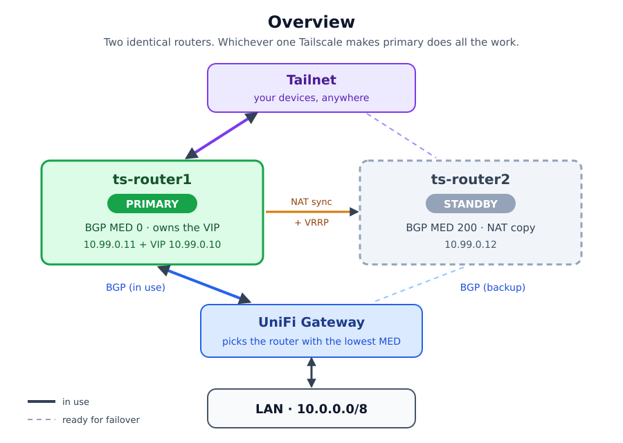
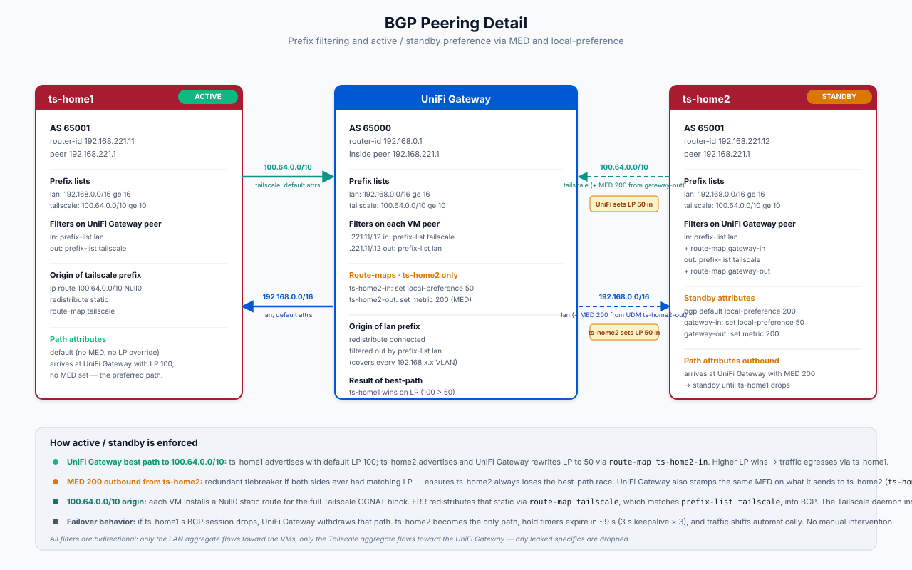

# UniFi + Debian/FRR + Tailscale (BGP)

Run Tailscale as a subnet router behind a UniFi Gateway using two
redundant Debian VMs. FRR's `bgpd` peers with the UniFi Gateway over eBGP; BGP path
attributes pick one VM as active and one as standby, and failover is
automatic when the active VM drops its session.

> **This repo used to document a pfSense + OSPF design.** It has been
> rewritten end-to-end for Debian + FRR + eBGP. If you need the old guide,
> check out a commit before this rewrite — git history is intact.

## Architecture



- `ts-home1` (active) and `ts-home2` (standby) are Debian 13 (Trixie) VMs
  running on separate Proxmox hosts.
- `ens18` is the WAN interface on **VLAN 220** (DHCP). Tailscale uses this
  to reach the tailnet.
- `ens19` is the inside interface on **VLAN 221**, a /24 BGP transit subnet.
  The UniFi Gateway peers with each VM across this VLAN.
- The VMs are **AS 65001**; the UniFi Gateway is **AS 65000**. eBGP exchanges
  exactly two aggregates: `192.168.0.0/16` (LAN) and `100.64.0.0/10`
  (Tailscale CGNAT).
- The Tailscale daemon installs per-peer `/32` routes inside the
  `100.64.0.0/10` aggregate. `iptables` masquerades LAN traffic to the VM's
  Tailscale IP on the way out so peers that haven't accepted your subnet
  routes can still send return traffic.

### BGP design



| Direction | Prefix(es) | Modifier | Effect |
|---|---|---|---|
| `ts-home1` → UniFi Gateway | `100.64.0.0/10` | default attrs | preferred at UniFi Gateway |
| `ts-home2` → UniFi Gateway | `100.64.0.0/10` | UniFi Gateway applies `local-preference 50` (inbound) | demoted at UniFi Gateway |
| UniFi Gateway → `ts-home1` | `192.168.0.0/16` | default attrs | normal return path |
| UniFi Gateway → `ts-home2` | `192.168.0.0/16` | UniFi Gateway applies `metric 200` (MED, outbound) | tagged as standby |

`prefix-list lan` permits `192.168.0.0/16 ge 16` only; `prefix-list tailscale`
permits `100.64.0.0/10 ge 10` only. Both lists are mirrored on the UniFi Gateway
and on the VMs so leaked specifics from either side are dropped. BGP timers
are `3 9` (keepalive 3 s, hold 9 s) on every neighbor, giving sub-10-second
failover.

## Address Plan

| Element | Value |
|---|---|
| LAN aggregate (multiple VLANs) | `192.168.0.0/16` |
| WAN transit VLAN | `192.168.220.0/24` (VLAN 220, DHCP) |
| BGP transit VLAN | `192.168.221.0/24` (VLAN 221) |
| UniFi Gateway inside peer | `192.168.221.1` |
| `ts-home1` inside | `192.168.221.11` |
| `ts-home2` inside | `192.168.221.12` |
| Tailscale CGNAT | `100.64.0.0/10` |
| UniFi Gateway AS | `65000` |
| Debian VMs AS | `65001` |

## Requirements

- A UniFi Gateway running a UniFi OS version with FRR/BGP support (works on all current models).
- A virtualisation host (Proxmox is assumed here; anything that supports
  Debian 13 will work). Two hosts if you want true HA across hardware.
- A Tailscale tailnet and access to the admin console for route approval.
- Two VLANs reachable from the UniFi Gateway — one for WAN egress to the VMs and
  one for the BGP transit subnet.

## Not Covered

- Installing the UniFi Gateway or provisioning VLANs on UniFi.
- Setting up a Tailscale tailnet.
- Installing Tailscale clients on remote devices.
- ACLs in Tailscale — see <https://tailscale.com/kb/1337/acl-syntax>.

## Important Notes

> The UniFi Gateway's `/etc/frr/frr.conf` **cannot** be edited directly on the CLI —
> the controller will overwrite it. The BGP config below must be pasted into
> the UniFi GUI (`Settings → Routing → BGP`) so the controller applies it
> through the supported path.

## UniFi Gateway Configuration

### BGP

In the UniFi GUI, go to `Settings → Routing → BGP` and paste the following.
Replace `192.168.0.1` with the router-id you want to advertise; the value
below is a sensible default if your primary LAN sits in `192.168.0.0/24`.

```
router bgp 65000
 bgp router-id 192.168.0.1
 bgp listen limit 10
 neighbor 192.168.221.11 remote-as 65001
 neighbor 192.168.221.11 timers 3 9
 neighbor 192.168.221.12 remote-as 65001
 neighbor 192.168.221.12 timers 3 9
 !
 address-family ipv4 unicast
  redistribute connected
  neighbor 192.168.221.11 soft-reconfiguration inbound
  neighbor 192.168.221.11 prefix-list tailscale in
  neighbor 192.168.221.11 prefix-list lan out
  neighbor 192.168.221.12 soft-reconfiguration inbound
  neighbor 192.168.221.12 prefix-list tailscale in
  neighbor 192.168.221.12 prefix-list lan out
  neighbor 192.168.221.12 route-map ts-home2-in in
  neighbor 192.168.221.12 route-map ts-home2-out out
 exit-address-family
exit
!
ip prefix-list lan seq 10 permit 192.168.0.0/16 ge 16
ip prefix-list tailscale seq 10 permit 100.64.0.0/10 ge 10
!
route-map ts-home2-in permit 10
 set local-preference 50
!
route-map ts-home2-out permit 10
 set metric 200
```

## VM Build (Proxmox)

Create two VMs with identical specs, one per Proxmox host:

| Setting | Value |
|---|---|
| OS | Debian 13 Trixie (netinstall) |
| Machine | q35 |
| BIOS | UEFI (OVMF) |
| CPU | 1 vCPU |
| RAM | 1 GB |
| Disk | 8 GB |
| `net0` (`ens18`) | VirtIO bridge → VLAN 220 (WAN) |
| `net1` (`ens19`) | VirtIO bridge → VLAN 221 (inside) |

Install with minimal/standard system utilities only — no desktop.

## Debian Base Configuration

Do everything below on **both** VMs unless noted.

### Hostname

```bash
# On ts-home1:
hostnamectl set-hostname ts-home1

# On ts-home2:
hostnamectl set-hostname ts-home2
```

### `/etc/network/interfaces` — `ts-home1`

```
auto lo
iface lo inet loopback

auto ens18
iface ens18 inet dhcp

auto ens19
iface ens19 inet static
    address 192.168.221.11
    netmask 255.255.255.0
```

### `/etc/network/interfaces` — `ts-home2`

```
auto lo
iface lo inet loopback

auto ens18
iface ens18 inet dhcp

auto ens19
iface ens19 inet static
    address 192.168.221.12
    netmask 255.255.255.0
```

> No default gateway on `ens19` — WAN (`ens18`) DHCP provides the default
> route. Tailscale egresses via WAN. Adding a gateway to the inside
> interface will black-hole tailnet traffic.

```bash
systemctl restart networking
```

### IP Forwarding

```bash
cat > /etc/sysctl.d/99-forwarding.conf << 'EOF'
net.ipv4.ip_forward = 1
net.ipv4.conf.all.forwarding = 1
net.ipv6.conf.all.forwarding = 1
EOF

sysctl --system
```

## FRR Installation

```bash
apt update && apt install -y frr frr-pythontools
```

### `/etc/frr/daemons`

Set `zebra` and `bgpd` to `yes`; leave the rest as-is:

```
zebra=yes
bgpd=yes
```

## FRR Configuration

### `/etc/frr/frr.conf` — `ts-home1` (active)

```
frr version 9.1
frr defaults traditional
hostname ts-home1
service integrated-vtysh-config
!
ip route 100.64.0.0/10 Null0
!
router bgp 65001
 bgp router-id 192.168.221.11
 no bgp network import-check
 neighbor 192.168.221.1 remote-as 65000
 neighbor 192.168.221.1 update-source 192.168.221.11
 neighbor 192.168.221.1 timers 3 9
 !
 address-family ipv4 unicast
  redistribute static route-map tailscale
  no neighbor 192.168.221.1 send-community
  neighbor 192.168.221.1 soft-reconfiguration inbound
  neighbor 192.168.221.1 prefix-list lan in
  neighbor 192.168.221.1 prefix-list tailscale out
 exit-address-family
exit
!
ip prefix-list lan seq 10 permit 192.168.0.0/16 ge 16
ip prefix-list tailscale seq 10 permit 100.64.0.0/10 ge 10
!
route-map tailscale permit 10
 match ip address prefix-list tailscale
exit
!
```

### `/etc/frr/frr.conf` — `ts-home2` (standby)

```
frr version 9.1
frr defaults traditional
hostname ts-home2
service integrated-vtysh-config
!
ip route 100.64.0.0/10 Null0
!
router bgp 65001
 bgp router-id 192.168.221.12
 bgp default local-preference 200
 no bgp network import-check
 neighbor 192.168.221.1 remote-as 65000
 neighbor 192.168.221.1 update-source 192.168.221.12
 neighbor 192.168.221.1 timers 3 9
 !
 address-family ipv4 unicast
  redistribute static route-map tailscale
  no neighbor 192.168.221.1 send-community
  neighbor 192.168.221.1 soft-reconfiguration inbound
  neighbor 192.168.221.1 prefix-list lan in
  neighbor 192.168.221.1 prefix-list tailscale out
  neighbor 192.168.221.1 route-map gateway-in in
  neighbor 192.168.221.1 route-map gateway-out out
 exit-address-family
exit
!
ip prefix-list lan seq 10 permit 192.168.0.0/16 ge 16
ip prefix-list tailscale seq 10 permit 100.64.0.0/10 ge 10
!
route-map gateway-in permit 10
 set local-preference 50
exit
!
route-map gateway-out permit 10
 set metric 200
exit
!
route-map tailscale permit 10
 match ip address prefix-list tailscale
exit
!
```

### Permissions and Start

FRR runs as the `frr` user and will silently load an empty config if it
can't read `frr.conf`. Set ownership before starting:

```bash
chown frr:frr /etc/frr/frr.conf
chmod 640 /etc/frr/frr.conf
systemctl enable --now frr
```

### Verify the FRR Version Match

The version on line 1 of `frr.conf` must match the installed version or FRR
will refuse to load the config:

```bash
vtysh --version
```

If it reports something like `9.1.2`, update line 1 to `frr version 9.1.2`
and restart:

```bash
systemctl restart frr
```

## Tailscale Installation

```bash
curl -fsSL https://tailscale.com/install.sh | sh
```

### UDP GRO Forwarding

Tailscale will warn about suboptimal UDP GRO on `ens18` if this isn't set.
Install `ethtool` and apply the tunable persistently:

```bash
apt install -y ethtool
```

```bash
cat > /etc/systemd/system/tailscale-ethtool.service << 'EOF'
[Unit]
Description=Tailscale ethtool UDP GRO fix
After=network-online.target
Wants=network-online.target

[Service]
Type=oneshot
ExecStart=/sbin/ethtool -K ens18 rx-udp-gro-forwarding on rx-gro-list off
RemainAfterExit=yes

[Install]
WantedBy=multi-user.target
EOF

systemctl daemon-reload
systemctl enable --now tailscale-ethtool
```

### Bring Up Tailscale

Replace the `--advertise-routes` list with the LAN subnets you actually
want reachable from the tailnet:

```bash
tailscale up \
  --advertise-routes=192.168.0.0/24,192.168.10.0/24,192.168.20.0/24,192.168.221.0/24 \
  --advertise-exit-node \
  --ssh
```

The command prints an auth URL. Open it in a browser to authenticate the
node. Repeat on the second VM — each node needs its own auth.

### Approve Routes in the Tailscale Admin Console

1. Go to <https://login.tailscale.com/admin/machines>.
2. For each of `ts-home1` and `ts-home2`: three-dot menu → **Edit route
   settings** → enable all advertised subnet routes and **Use as exit node**.


### Disable Route Acceptance on the VMs

These VMs advertise routes; they should not absorb routes from other
Tailscale nodes into the kernel routing table.

```bash
tailscale set --accept-routes=false
```

## NAT Configuration

LAN traffic heading into the tailnet is masqueraded as the VM's Tailscale
IP so peers without your subnet routes accepted (phones, laptops, exit-node
users) can route return traffic. Peers that explicitly accept your subnet
routes will work without NAT, but masquerading is worth keeping for
robustness.

```bash
apt install -y iptables-persistent

iptables -t nat -A POSTROUTING -s 192.168.0.0/16 -o tailscale0 -j MASQUERADE

netfilter-persistent save
```

`tailscale0` is the daemon's interface on Linux. The rule masquerades to
the VM's current Tailscale IP automatically — no hardcoded `100.64.x.x`.

Verify:

```bash
iptables -t nat -L POSTROUTING -v --line-numbers
```

You should see a `MASQUERADE` rule with `tailscale0` as the output
interface and `192.168.0.0/16` as the source.

## Verification

### FRR Startup

```bash
journalctl -u frr --no-pager | tail -30
```

All four daemons should report `state -> up`:

```
watchfrr: zebra state -> up
watchfrr: mgmtd state -> up
watchfrr: bgpd state -> up
watchfrr: staticd state -> up
watchfrr: all daemons up, doing startup-complete notify
```

These `NB_OP_CHANGE` messages appear on every restart and are benign —
they're a race between `zebra` and `mgmtd` during startup with no
operational impact:

```
zebra: NB_OP_CHANGE: oper_walk_done: ERROR: Error sending notification message for path: /frr-interface:lib/interface[name="ens18"]/state
```

The line below confirms the UniFi Gateway pushed its full table and the session
is up:

```
bgpd: rcvd End-of-RIB for IPv4 Unicast from 192.168.221.1 in vrf default
```

### BGP

```bash
# Session — 192.168.221.1 should be in Established
vtysh -c "show bgp summary"

# Full BGP table — 100.64.0.0/10 must be present once Tailscale is up
vtysh -c "show ip bgp"

# What UniFi Gateway is sending us (your LAN prefixes)
vtysh -c "show ip bgp neighbors 192.168.221.1 received-routes"

# What we're advertising back (should be 100.64.0.0/10)
vtysh -c "show ip bgp neighbors 192.168.221.1 advertised-routes"
```

### Routing

```bash
# Blackhole route for the Tailscale aggregate — needed for redistribution
ip route show 100.64.0.0/10

# Full kernel routing table
ip route show
```

### Tailscale

```bash
tailscale status
tailscale status --peers=false
```

### From the UniFi Gateway

SSH to the gateway and confirm both neighbors are up and `ts-home1` is
preferred (lower MED received, higher local-preference):

```bash
vtysh -c "show bgp summary"
vtysh -c "show ip bgp 100.64.0.0/10"
```

## Tailscale DNS (optional)

To resolve tailnet hostnames from LAN clients, forward `*.ts.net` (or your
tailnet's MagicDNS domain) to Quad100. On a UniFi-managed network, add a
domain override to whatever resolver your LAN uses; if you happen to run
Unbound somewhere, the entry looks like:

- **Domain:** `ts.net` (or your tailnet's MagicDNS domain)
- **Lookup Server IP:** `100.100.100.100`

References:

- <https://tailscale.com/kb/1081/magicdns>
- <https://tailscale.com/kb/1381/what-is-quad100>

## Watchdog Script

The script below checks the four things most likely to silently break
subnet routing — wedged Tailscale daemon, missing NAT rule, missing
blackhole route, downed BGP session — and restarts the relevant service.
Before relying on it, look at logs when things fail so you understand the
actual root cause:

```bash
journalctl -u tailscale --no-pager | tail -30
journalctl -u frr --no-pager | tail -30
```

### Install

```bash
cat > /usr/local/bin/tailscale-watchdog.sh << 'EOF'
#!/bin/bash

LOG="logger -t tailscale-watchdog"

if ! tailscale status > /dev/null 2>&1; then
    $LOG "Tailscale unresponsive, restarting"
    systemctl restart tailscale
    sleep 5
fi

if ! ip route show 100.64.0.0/10 | grep -q Null0; then
    $LOG "Blackhole route missing, restarting FRR"
    systemctl restart frr
fi

if ! iptables -t nat -L POSTROUTING | grep -q "tailscale0.*MASQUERADE\|MASQUERADE.*tailscale0"; then
    $LOG "NAT rule missing, re-applying"
    iptables -t nat -A POSTROUTING -s 192.168.0.0/16 -o tailscale0 -j MASQUERADE
fi

if ! vtysh -c "show bgp summary" | grep -q "192.168.221.1.*Established\|192.168.221.1.*[0-9]*:[0-9]*:[0-9]*"; then
    $LOG "BGP session down, restarting FRR"
    systemctl restart frr
fi
EOF

chmod +x /usr/local/bin/tailscale-watchdog.sh
```

### Schedule

```bash
echo "*/5 * * * * root /usr/local/bin/tailscale-watchdog.sh" > /etc/cron.d/tailscale-watchdog
```

Runs every 5 minutes. Logs go to syslog under the `tailscale-watchdog` tag:

```bash
grep tailscale-watchdog /var/log/syslog
```

## Troubleshooting

### BGP session won't establish

- **Wrong AS or peer IP:** confirm the UniFi Gateway config has the VM in AS 65001
  and the right neighbor IP; confirm the VM config has the UniFi Gateway as AS
  65000 at `192.168.221.1`.
- **Firewall on the inside VLAN:** UniFi Gateway LAN-In may block TCP/179 between
  `192.168.221.0/24` hosts. The default UniFi LAN policy allows intra-VLAN
  traffic; an explicit deny will kill BGP.
- **`update-source` mismatch:** the `neighbor … update-source` line on the
  VM must match the IP that's actually on `ens19`. If you mis-typed it, the
  session stays in `Active` and never moves to `Established`.
- **Config not loaded:** `vtysh -c "show running-config"` — if it's nearly
  empty, FRR couldn't read `frr.conf`. Re-check ownership and mode.

### Session up, but no prefixes exchanged

- **Prefix-list typo:** `show ip prefix-list` should list both `lan` and
  `tailscale` with their permit entries.
- **`bgp network import-check`:** must be disabled (`no bgp network
  import-check`) for the static `100.64.0.0/10` to be advertised before
  Tailscale installs anything in the kernel table.
- **`route-map tailscale` missing:** `redistribute static route-map tailscale`
  silently advertises nothing if the named map doesn't exist.

### LAN devices can't reach tailnet hosts

- **UniFi Gateway has the route?** `vtysh -c "show ip route bgp"` on the UniFi Gateway
  should list `100.64.0.0/10` via `192.168.221.11`. If it's via `.12`,
  your active VM is `ts-home2` — check why `ts-home1` lost the best-path
  race.
- **NAT rule missing on the active VM:** see [NAT Configuration](#nat-configuration).
- **Routes not approved in Tailscale admin console.**
- **Custom UniFi firewall policy blocking the traffic:** UniFi's default
  LAN-In policy lets clients route to BGP-learned destinations without an
  explicit rule. If you've added a restrictive policy (e.g. a default-deny
  on LAN-In or a VLAN-isolation rule), add an allow rule for traffic to
  `100.64.0.0/10`.

### Tailnet hosts can't reach LAN devices

- **NAT not translating:** packet-capture on `tailscale0` (with `tcpdump`)
  and confirm outbound packets have a `100.x.x.x` source, not a
  `192.168.x.x` one. If they don't, the masquerade rule isn't matching.
- **Asymmetric routing:** if the active VM differs in each direction,
  packets get dropped by stateful filters. Confirm both UniFi Gateway and tailnet
  agree on which VM is active.

### Failover slow or doesn't happen

- **BGP timers:** confirm `timers 3 9` on every neighbor — defaults
  (`60 180`) give you up to three minutes of black-holed traffic.
- **Tailscale primary subnet router stuck:** when `ts-home1` is down
  Tailscale should promote `ts-home2` as the primary route advertiser; if
  it doesn't, the route advertisement on `ts-home1` may be cached. Check
  the admin console.

## Migration from the pfSense + OSPF Version

Cutover is non-disruptive because the inside-VLAN IPs (`.11`, `.12`) are
reused — the UniFi Gateway peers with the same IPs, only the protocol underneath
changes from OSPF to BGP.

1. Build `ts-home1`. Bring up FRR and Tailscale. Approve routes in the
   admin console.
2. Build `ts-home2`. Repeat.
3. Confirm BGP is `Established` on both new VMs:
   `vtysh -c "show bgp summary"`.
4. Confirm Tailscale subnet routes are active in the admin console.
5. Test: ping a LAN host from a tailnet peer and vice versa.
6. Shut down the old pfSense VMs (`pf1`, `pf2`).
7. Verify both BGP sessions stay up after pfSense is gone.
8. Decommission the pfSense VMs.

> Because the inside IPs are being reused, the pfSense VMs must be fully
> powered off before the new VMs come up on the same IPs — otherwise you
> get a VLAN 221 IP conflict.

The UniFi Gateway BGP config replaces the OSPF config in
`Settings → Routing`. Once the new VMs are up, remove the OSPF area from
the UniFi controller; OSPF and BGP can coexist briefly during the cutover
but the OSPF adjacency to pfSense will fail anyway once pfSense is off.
