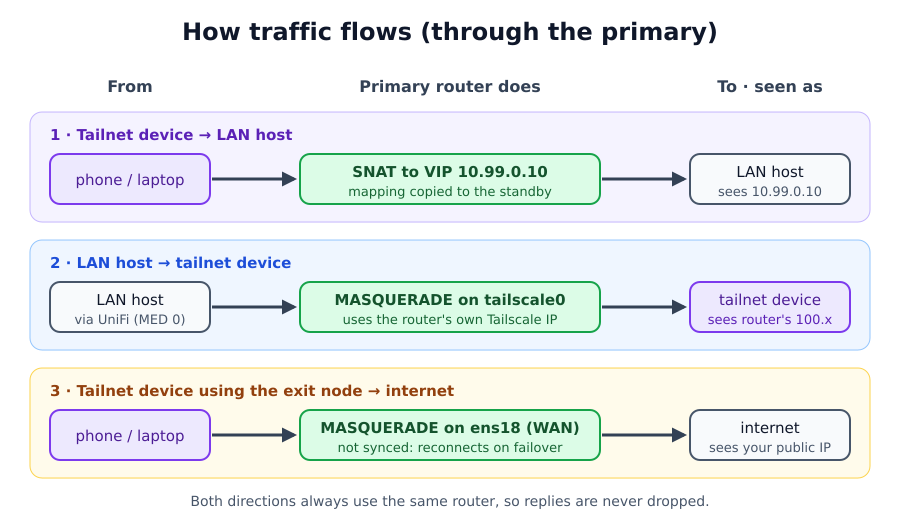
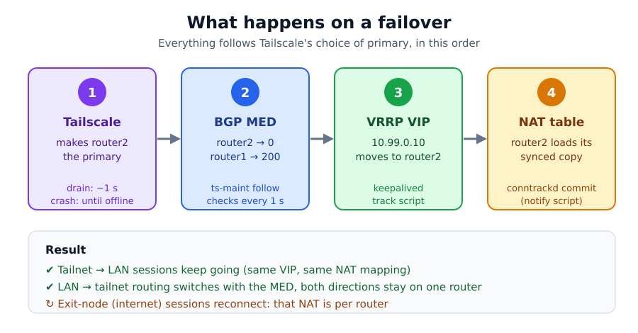

# UniFi + Debian/FRR + Tailscale (BGP, HA)

Run Tailscale as a highly available subnet router (and exit node) behind a UniFi Gateway, using two Debian VMs.

- FRR on each VM peers with the UniFi Gateway over **eBGP** and advertises the Tailscale range `100.64.0.0/10`.
- Tailscale picks one VM as the **primary subnet router**. Everything else **follows that primary**:
  - a small loop sets the BGP **MED** so the UniFi Gateway sends LAN → tailnet traffic through the same VM
    (symmetric routing);
  - a **VRRP VIP** (keepalived) that tailnet → LAN traffic is SNATed to moves to the same VM.
- **conntrackd** copies the NAT table to the standby, so open connections survive a failover.
- `ts-maint` drains a VM before maintenance (`ts-maint reboot`), so planned reboots are seamless.

> **History.** This repo first documented a pfSense + OSPF design, then a Debian + FRR design where the UniFi
> Gateway preferred one VM with a fixed local-preference. This version replaces the fixed preference with
> "follow the Tailscale primary" and adds the shared SNAT VIP and connection sync. See
> [Migrating from the previous version](#migrating-from-the-previous-version-of-this-guide).

All addresses below are **examples**: substitute your own.

### Config generator

Rather fill in a form? **[Open the config generator](https://mzac.github.io/unifi-debian-tailscale-bgp/generator/)**
(source: [`generator/`](generator/)). Enter your addresses and it produces:
- the UniFi BGP config;
- every file for both routers;
- the `tailscale up` command and a policy snippet;
- a zip per router with an `install.sh`.

It runs entirely in your browser: nothing you type is sent anywhere.

`install.sh` installs the packages and copies the files into place. It backs up anything it replaces, adds the NAT
rules only if they're missing, and enables the services; `--dry-run` shows the steps first. It does **not** change
your network interfaces, log in to Tailscale or touch the UniFi Gateway: those stay manual. Its output matches the
files in [`files/`](files/): `node generator/test.js` checks that.

## Architecture


| Piece | Runs on | Job |
|---|---|---|
| Tailscale | both VMs | Same subnet routes + exit node on both; Tailscale makes one VM **primary** (sticky until it goes offline or stops advertising). |
| FRR (`bgpd`) | both VMs | Advertises `100.64.0.0/10` (a Null0 static, redistributed) to the UniFi Gateway; learns the LAN routes. |
| `ts-maint follow` | both VMs | Every second: MED **0** on the Tailscale primary, **200** on the standby. The UniFi Gateway takes the lowest MED, so LAN → tailnet goes to the primary. |
| keepalived | both VMs | VRRP VIP `10.99.0.10`; a track script adds +50 priority on the Tailscale primary, so the VIP follows it. |
| iptables | both VMs | tailnet → LAN is SNATed to the VIP; LAN → tailnet is masqueraded to the VM's Tailscale IP; exit-node traffic is masqueraded to the WAN. |
| conntrackd | both VMs | FTFW sync of the conntrack/NAT table over the transit VLAN; the new VRRP master commits it into the kernel. |
| `ts-maint` | both VMs | `status`, `drain`, `undrain`, `reboot` (drain first, then reboot). |



### Why everything follows the Tailscale primary

Tailscale decides on its own which subnet router is primary, and there is no setting to prefer one. A remote
tailnet client only accepts subnet traffic from the node it currently considers primary. If the UniFi Gateway sent
LAN → tailnet traffic through the *other* VM, replies would be dropped. So instead of pinning a preferred VM in
BGP, the VMs **measure** who is primary and steer BGP (MED) and the SNAT VIP to match. When Tailscale fails over,
both follow within about a second.

### Why SNAT to a shared VIP (and not Tailscale's own SNAT, or no SNAT)

| Option | Result |
|---|---|
| Tailscale's default SNAT (`--snat-subnet-routes=true`) | LAN hosts see the VM's own address. A failover changes the source address, so **every open session drops**. |
| No SNAT (`--snat-subnet-routes=false`, routed) | LAN hosts see the real `100.x` source and sessions survive. But **LAN hosts that also run Tailscale** answer `100.x` through their *own* `tailscale0`, and the client drops those replies (wrong node). |
| **SNAT to a VRRP VIP + conntrackd (this guide)** | LAN hosts always see `10.99.0.10` and reply over the LAN, Tailscale hosts included. The VIP and the NAT table move together, so sessions survive a failover. |

Exit-node (internet) traffic is still masqueraded per VM on the WAN interface, so exit-node sessions do drop on
failover; clients reconnect.

## Address plan (example)

| Element | Example value |
|---|---|
| LAN aggregate (all your VLANs) | `10.0.0.0/8` |
| LAN subnets you advertise to the tailnet | e.g. `10.10.0.0/24`, `10.20.0.0/24` |
| WAN VLAN for the VMs (DHCP, internet egress) | VLAN 98, `10.98.0.0/24` |
| BGP transit VLAN | VLAN 99, `10.99.0.0/24` |
| UniFi Gateway on the transit VLAN | `10.99.0.1` |
| `ts-router1` / `ts-router2` (ens19) | `10.99.0.11` / `10.99.0.12` |
| SNAT VIP (VRRP) | `10.99.0.10` |
| Tailscale range | `100.64.0.0/10` |
| UniFi Gateway AS / VM AS | `65000` / `65001` |

## Requirements

- A UniFi Gateway with BGP support (UniFi OS `Settings → Routing → BGP`).
- Two VMs, ideally on two different hypervisor hosts (Proxmox is assumed here).
- A Tailscale tailnet and admin access to approve routes.
- Two VLANs reachable from the UniFi Gateway: a WAN VLAN for the VMs' internet egress, and the BGP transit VLAN.

Not covered: building the UniFi network or VLANs, creating the tailnet, Tailscale clients, tailnet policy design
(see <https://tailscale.com/kb/1337/acl-syntax>).

## UniFi Gateway configuration

> The UniFi Gateway's `/etc/frr/frr.conf` **cannot** be edited on the CLI: the controller overwrites it. Paste the
> BGP config into the UniFi UI (`Settings → Routing → BGP`).

Both VMs are configured the same way: the MED they send decides which one wins. **Do not** add a local-preference
route-map for either VM: local-preference outranks MED and would pin the path, breaking the symmetric routing.

```
router bgp 65000
 bgp router-id 10.10.0.1
 neighbor 10.99.0.11 remote-as 65001
 neighbor 10.99.0.11 timers 3 9
 neighbor 10.99.0.12 remote-as 65001
 neighbor 10.99.0.12 timers 3 9
 !
 address-family ipv4 unicast
  redistribute connected
  neighbor 10.99.0.11 soft-reconfiguration inbound
  neighbor 10.99.0.11 prefix-list tailscale in
  neighbor 10.99.0.11 prefix-list lan out
  neighbor 10.99.0.12 soft-reconfiguration inbound
  neighbor 10.99.0.12 prefix-list tailscale in
  neighbor 10.99.0.12 prefix-list lan out
 exit-address-family
exit
!
ip prefix-list lan seq 10 permit 10.0.0.0/8 ge 8
ip prefix-list tailscale seq 10 permit 100.64.0.0/10 ge 10
```

Both paths come from the same neighbor AS (65001), so the gateway compares MED without extra settings. The prefix
lists keep each side to its aggregate: only LAN prefixes go to the VMs, and only the Tailscale aggregate comes back.

## VM build (Proxmox)

Two identical VMs, one per host:

| Setting | Value |
|---|---|
| OS | Debian 13 (Trixie), minimal install |
| Machine / BIOS | q35 / UEFI (OVMF) |
| CPU / RAM / disk | 1 vCPU / 1 GB / 8 GB |
| `net0` (`ens18`) | VirtIO → WAN VLAN 98 (DHCP; reserve the address in UniFi) |
| `net1` (`ens19`) | VirtIO → transit VLAN 99 |

## Debian base configuration (both VMs)

```bash
hostnamectl set-hostname ts-router1      # ts-router2 on the other VM
```

`/etc/network/interfaces` (`ts-router2`: `10.99.0.12`):

```
auto lo
iface lo inet loopback

auto ens18
iface ens18 inet dhcp

auto ens19
iface ens19 inet static
    address 10.99.0.11
    netmask 255.255.255.0
```

> No gateway on `ens19`: the default route comes from WAN DHCP, which is how Tailscale reaches the internet. A
> gateway on the inside interface black-holes tailnet traffic.

IP forwarding:

```bash
cat > /etc/sysctl.d/99-forwarding.conf << 'EOF'
net.ipv4.ip_forward = 1
net.ipv4.conf.all.forwarding = 1
net.ipv6.conf.all.forwarding = 1
EOF
sysctl --system
```

Packages:

```bash
apt update && apt install -y frr frr-pythontools keepalived conntrackd iptables-persistent ethtool python3
```

## FRR

In `/etc/frr/daemons` set `bgpd=yes` (zebra, staticd and mgmtd start on their own).

`/etc/frr/frr.conf` for `ts-router1` is [`files/frr.ts-router1.conf`](files/frr.ts-router1.conf) (and
[`files/frr.ts-router2.conf`](files/frr.ts-router2.conf)). Both are identical except for the router-id and
`update-source`. The important parts:

```
ip route 100.64.0.0/10 Null0                      ! origin of the advertised aggregate
route-map ts-med permit 10                        ! rewritten every second by ts-maint follow
 set metric 200
router bgp 65001
 neighbor 10.99.0.1 timers 3 9
 address-family ipv4 unicast
  redistribute static route-map tailscale
  neighbor 10.99.0.1 prefix-list lan in
  neighbor 10.99.0.1 prefix-list tailscale out
  neighbor 10.99.0.1 route-map ts-med out
```

```bash
chown frr:frr /etc/frr/frr.conf && chmod 640 /etc/frr/frr.conf
systemctl enable --now frr
```

The `frr version` line must match `vtysh --version`, or FRR ignores the file.

## Tailscale

```bash
curl -fsSL https://tailscale.com/install.sh | sh
```

UDP GRO forwarding on the WAN interface (Tailscale warns without it):

```bash
cat > /etc/systemd/system/tailscale-ethtool.service << 'EOF'
[Unit]
Description=Tailscale ethtool UDP GRO fix
After=network-online.target
Wants=network-online.target

[Service]
Type=oneshot
ExecStart=/sbin/ethtool -K ens18 rx-udp-gro-forwarding on rx-gro-list off
RemainAfterExit=yes

[Install]
WantedBy=multi-user.target
EOF
systemctl daemon-reload && systemctl enable --now tailscale-ethtool
```

Bring it up with the **same routes on both VMs** and Tailscale's own SNAT **off** (the VIP SNAT below replaces it):

```bash
tailscale up \
  --advertise-routes=10.10.0.0/24,10.20.0.0/24,10.99.0.0/24 \
  --advertise-exit-node \
  --snat-subnet-routes=false \
  --accept-routes=false \
  --ssh
```

Each VM prints its own login URL. Then, in the admin console (**Machines →** each VM **→ Edit route settings**),
approve every advertised subnet and **Use as exit node**. Or let the tailnet policy approve them automatically:

```jsonc
"autoApprovers": {
  "routes":   { "10.0.0.0/8": ["tag:subnet-router"] },
  "exitNode": ["tag:subnet-router"],
},
```

Use hostnames that start with the same prefix (`ts-router1`, `ts-router2`): `ts-maint` finds its peer by it.

> `tailscale status` shows a health warning, "snat-subnet-routes is disabled while advertising as an exit node".
> That's expected here: the iptables rules below do the NAT. If you monitor Tailscale health, exclude that message.

## NAT (iptables)

Add these to the `*nat` table in `/etc/iptables/rules.v4` (full section:
[`files/rules.v4.nat`](files/rules.v4.nat)), then `netfilter-persistent reload`:

```
# LAN -> tailnet: appear as this VM's Tailscale IP (peers without your subnet routes can answer)
-A POSTROUTING -s 10.0.0.0/8 -o tailscale0 -j MASQUERADE
# exit node: tailnet -> internet via WAN
-A POSTROUTING -s 100.64.0.0/10 -o ens18 -j MASQUERADE
# tailnet -> LAN: SNAT to the shared VIP (state synced by conntrackd)
-A POSTROUTING -s 100.64.0.0/10 -o ens19 -j SNAT --to-source 10.99.0.10
```

The SNAT rule is harmless on the standby: it only carries traffic once it owns the VIP and is the Tailscale primary.

## ts-maint (role, MED follow, drain)

Install on both VMs:

| File | Install as |
|---|---|
| [`files/ts-maint`](files/ts-maint) | `/usr/local/sbin/ts-maint` (mode 0755) |
| [`files/ts-maint.default`](files/ts-maint.default) | `/etc/default/ts-maint` (set `PEER_IP` to the *other* VM) |
| [`files/ts-bgp-follow.service`](files/ts-bgp-follow.service) | `/etc/systemd/system/` |
| [`files/ts-maint-restore.service`](files/ts-maint-restore.service) | `/etc/systemd/system/` |
| [`files/ts-role.sh`](files/ts-role.sh) | `/etc/profile.d/ts-role.sh` (optional login banner, also shown over Tailscale SSH) |

```bash
systemctl daemon-reload
systemctl enable --now ts-bgp-follow ts-maint-restore
ts-maint status
```

| Command | What it does |
|---|---|
| `ts-maint status` | Tailscale role, BGP state and MED, peer, who owns the VIP. |
| `ts-maint drain` | Withdraws this VM's Tailscale routes and exit node (the peer becomes primary at once), stops keepalived (the VIP moves at once), shuts the BGP session (the gateway withdraws at once). Refuses if the peer is offline. |
| `ts-maint undrain` | Puts back the saved routes, BGP session and keepalived. |
| `ts-maint reboot` | Drain, check that the peer took over, reboot. Runs as a detached systemd job, because the drain can cut the SSH session you started it from. At boot, `ts-maint-restore` undrains. |

> Don't run `write memory` in FRR while a VM is drained: it saves the `neighbor … shutdown`. `ts-maint-restore`
> removes a saved shutdown at boot anyway.

## keepalived (the SNAT VIP)

`/etc/keepalived/keepalived.conf`: [`files/keepalived.ts-router1.conf`](files/keepalived.ts-router1.conf) /
[`files/keepalived.ts-router2.conf`](files/keepalived.ts-router2.conf). Both VMs start at priority 100. The track
script `ts-maint is-primary` adds 50 on the Tailscale primary and preempt is on, so the VIP always moves to the
primary. Unicast VRRP between the two inside addresses; the state changes call the conntrackd script below.

## conntrackd (connection sync)

| File | Install as |
|---|---|
| [`files/conntrackd.ts-router1.conf`](files/conntrackd.ts-router1.conf) / [`…ts-router2.conf`](files/conntrackd.ts-router2.conf) | `/etc/conntrackd/conntrackd.conf`; fill in this VM's WAN and Tailscale IPs under `Address Ignore` |
| [`files/primary-backup.sh`](files/primary-backup.sh) | `/etc/conntrackd/primary-backup.sh` (mode 0755) |
| [`files/conntrackd.service.override.conf`](files/conntrackd.service.override.conf) | `/etc/systemd/system/conntrackd.service.d/override.conf` |
| [`files/keepalived.service.override.conf`](files/keepalived.service.override.conf) | `/etc/systemd/system/keepalived.service.d/override.conf` |

`primary-backup.sh` is the conntrack-tools example script with **one change**. When conntrackd isn't answering,
the original removes the lock file and launches its own `conntrackd -d` outside systemd. This version runs
`systemctl start conntrackd` instead, so there's never a second, unmanaged copy.

The two systemd overrides set the start order: **network up → conntrackd → keepalived.** Without them, conntrackd
can start before `ens19` has its address and fail ("can't open channel socket: Cannot assign requested address"),
using up its restarts in one second. keepalived's script then started a second copy, and the unit stayed "failed".

```bash
mkdir -p /etc/systemd/system/conntrackd.service.d /etc/systemd/system/keepalived.service.d
# copy the files above into place, then:
systemctl daemon-reload
systemctl enable --now conntrackd keepalived
```

## Verification

```bash
ts-maint status                                    # one ACTIVE, one standby; the VIP on the ACTIVE one
vtysh -c "show bgp summary"                        # neighbor 10.99.0.1 Established
vtysh -c "show ip bgp neighbors 10.99.0.1 advertised-routes"   # 100.64.0.0/10, metric 0 (primary) / 200 (standby)
ip -4 addr show dev ens19                          # 10.99.0.10 only on the primary
iptables -t nat -S POSTROUTING                     # the three rules above
systemctl --failed                                 # nothing
pgrep -a conntrackd                                # exactly ONE process, started by systemd
conntrackd -s                                      # primary: "cache internal" ~= standby: "cache external"
```

On the UniFi Gateway (SSH):

```bash
vtysh -c "show ip bgp 100.64.0.0/10"               # both paths; best = metric 0
```

## Failover behaviour



| Event | What happens |
|---|---|
| `ts-maint reboot` / `drain` (planned) | The Tailscale primary moves in about 1 s, the VIP immediately after (keepalived stopped), the gateway path at once (BGP shutdown). conntrackd's commit gives the peer every NAT mapping, so tailnet → LAN sessions continue. |
| The primary VM dies (unplanned) | Tailscale notices the node offline and promotes the other one. That detection dominates; then MED and VIP follow within about a second. The BGP hold timer is 9 s. |
| The old primary comes back | Tailscale may **fail back** to the oldest subnet router, and there's no knob to prevent that. MED, VIP and conntrackd follow both ways, so a fail-back is a blip like a drain. |

## Troubleshooting

**conntrackd failed after a reboot / "1 failed unit(s): conntrackd.service".** The systemd overrides are missing.
Check `pgrep -a conntrackd`: a copy started by keepalived's script runs with `-d`. Install the overrides and the
patched script, stop the stray copy (`pkill -f 'conntrackd .* -d$'`), then `systemctl reset-failed conntrackd &&
systemctl start conntrackd`. On the standby, `conntrackd -n` asks the primary for a full resync. Never delete
`/var/lock/conntrack.lock` while a conntrackd process exists. Stopping a second copy also removes the shared
control socket `/var/run/conntrackd.ctl`, so restart the remaining one.

**Standby's external cache differs a lot from the primary's internal cache.** The sync isn't working: check UDP
3780 between the two inside addresses, that both VMs run conntrackd, and `conntrackd -s` on both for send/receive
errors. A few entries of difference is normal.

**BGP won't establish.** Check the AS numbers and neighbor addresses on both sides, and that `update-source`
matches the address on `ens19`. TCP/179 must be allowed on the transit VLAN. If `vtysh -c "show running-config"`
is nearly empty, FRR couldn't read `frr.conf` (ownership or mode).

**Session up but nothing exchanged.** `no bgp network import-check` must be set, the `tailscale` route-map must
exist, and the prefix lists must match on both sides.

**LAN can't reach the tailnet.** On the gateway, `show ip bgp 100.64.0.0/10` must show the primary with metric 0.
`journalctl -u ts-bgp-follow` shows the MED changes. A leftover local-preference route-map on the gateway
overrides MED: remove it. Routes must be approved in the Tailscale admin console.

**The tailnet can't reach the LAN.** `ip -4 addr show dev ens19` on the primary must hold the VIP
(`journalctl -u keepalived`). The SNAT rule must be present, and `tailscale debug prefs` must show `NoSNAT: true`
(with Tailscale's SNAT on, its MASQUERADE runs first and the VIP is never used).

## Migrating from the previous version of this guide

The previous version pinned the first VM as active with a local-preference route-map on the gateway and on the
standby VM, and used Tailscale's own SNAT. To move to this design, without an outage:

1. On both VMs: install keepalived, conntrackd, `ts-maint` and the overrides (sections above). Start keepalived
   and conntrackd. Check that the VIP sits on the Tailscale primary and that the caches sync.
2. Add the `ts-med` route-map to FRR on both VMs and enable `ts-bgp-follow`. Remove the standby's
   `gateway-in` / `gateway-out` route-maps and `bgp default local-preference`.
3. On the gateway: remove the standby's local-preference route-map (and the MED route-map towards it). From now
   on the gateway follows the VMs' MED.
4. Add the SNAT-to-VIP and exit-node MASQUERADE rules, then `tailscale set --snat-subnet-routes=false` on both VMs.
5. Test a planned failover: keep an SSH session from a tailnet device to a LAN host open, run
   `ts-maint reboot` on the primary, and check that the session survives.

Rollback: `tailscale set --snat-subnet-routes=true` on both VMs (Tailscale's MASQUERADE comes first again), then
optionally stop keepalived.

The old **watchdog cron script** was dropped. It restarted FRR whenever the BGP session was down, which fights a
deliberate `ts-maint drain`. Use your monitoring instead: BGP state, `systemctl --failed`, `tailscale status` health.

## Tailscale DNS (optional)

To resolve tailnet names from LAN clients, forward your tailnet's MagicDNS domain (`<tailnet>.ts.net`) to
`100.100.100.100` from whatever resolver your LAN uses. See <https://tailscale.com/kb/1081/magicdns>.
